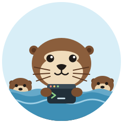

<p align="center"></p>

# otterpack

Spin up the right team of coding agents for your project. Each project has its own team(s), and they evolve with time and requirements.

A **team** is a set of **seats**. Each seat is a [Claude Code](https://docs.anthropic.com/en/docs/claude-code) or [Codex](https://github.com/openai/codex) session with its own role (a **persona**). It runs in its own tmux session and opens in its own VS Code terminal, with its icon and color. After a window reload, a container restart or a rebuild, every seat comes back on the same conversation.

Start from a template that fits the project (`otterpack init`), then shape the team as the project changes. Add a seat when a new role is needed, disable one you don't need for now, and add a kit of skills when the stack grows. The seats' personas, skills and subagents come from a shared **library**, pinned per project, so an improved persona or skill reaches a project when you run `otterpack update`.

otterpack is at 0.x: it works and is used daily, but `team.yaml`, `lock.json` and the commands may still change between minor versions (the [changelog](CHANGELOG.md) says how to upgrade). Today a project runs one team, described in `.otterpack/team.yaml`. What is planned before 1.0 is in the [design doc](docs/design.md#road-to-10).

```
$ otterpack status
SEAT        LABEL      HARNESS  PERSONA        STATE             CONVERSATION
claude-ar   Architect  claude   architect      running (claude)  947052c5-653c-48dc-bd8c-6a64cb0026d3
claude-web  Web dev    claude   web-developer  running (claude)  1c0e5a7d-28b4-4f3a-9d61-0f2b7e9a4c11
codex-api   API dev    codex    web-developer  stopped           5579260a-96a6-414b-b738-9fab7a8772de
```

- [Requirements](#requirements)
- [Install](#install)
- [Quick start](#quick-start)
- [Manage the team](#manage-the-team)
- [team.yaml](#teamyaml)
- [What sync writes](#what-sync-writes)
- [The library](#the-library)
- [Devcontainers](#devcontainers)
- [Troubleshooting](#troubleshooting)
- [Develop](#develop) · [Design](docs/design.md) · [Changelog](CHANGELOG.md) · [License](#license)

## Requirements

- Linux, including WSL and devcontainers, which is where otterpack is tested. macOS should work with `brew install tmux flock`, but it is untested.
- Node.js 22.6 or later, git, tmux, and `flock` (part of util-linux on Linux).
- The harness CLIs your seats use: `claude`, `codex`, or both, already logged in.
- VS Code, for one terminal per seat. It is optional: `otterpack up` works in any terminal.

## Install

otterpack installs from a release tag. The built CLI is committed, so the install doesn't need a build step.

```bash
npm install -g https://github.com/soatdev-it/otterpack/archive/refs/tags/v0.6.2.tar.gz
otterpack --version        # 0.6.2
```

<details>
<summary>From a private fork, or if the command above fails</summary>

Clone the tag, pack it, and install the package file. This works over HTTPS (with `gh auth setup-git`, or VS Code's forwarded git credentials) and over SSH.

```bash
D=$(mktemp -d)
git clone --depth 1 --branch v0.6.2 https://github.com/soatdev-it/otterpack.git "$D/src"
(cd "$D" && npm pack "$D/src") && npm install -g "$D"/otterpack-*.tgz && rm -rf "$D"
```

Don't use `npm install -g git+https://…`. npm's global install from git leaves this package half-unpacked, without `cli/dist` (seen with npm 10.9).

`EACCES` means your user can't write to npm's global folder: check `npm config get prefix`. `command not found` after the install means `$(npm config get prefix)/bin` is not on your `PATH`.
</details>

To keep otterpack installed across devcontainer rebuilds, see [Devcontainers](#devcontainers).

## Quick start

```bash
cd your-project
otterpack init            # writes .otterpack/team.yaml from the web-team template, then syncs
otterpack doctor          # checks tmux, the harness CLIs, logins and persistence
git add -A .otterpack .claude .agents .vscode
git commit -m "Add the agent team"
```

Then reload the VS Code window (Command Palette → **Developer: Reload Window**). Each seat opens in its own terminal and runs `otterpack up <seat>`. VS Code first asks whether to allow the folder's automatic tasks: choose **Allow**.

On its **first** launch, a seat gets one kickoff message: read your persona file (and the project charter, if any), and keep your notes in your seat folder. After that, the seat **resumes** its conversation, with no new kickoff.

When a seat's brief changes later, its next start resumes the conversation with a short **re-brief**, which says what changed and which files to read again. A brief changes when you give the seat another persona, edit its persona, charter or addendum, or `otterpack update` brings a new version of the persona. `status` names the seats that haven't had their re-brief yet, and so do `sync` and `update`. To re-brief a running seat now, restart it with `otterpack stop <seat>`, then `otterpack up <seat>`.

Without VS Code, `otterpack up` starts every seat in the background, and `otterpack up <seat>` attaches to one seat. Detach with tmux's `Ctrl-b d`.

The template is a starting point. Edit `.otterpack/team.yaml` (or use the commands below), then run `otterpack sync`. Other options:

- **Pick the seats:** `otterpack list` shows the library's templates, personas and kits, each with one line about it. Then run `otterpack init --template <name>`.
- **Your own library:** `otterpack init --library <git-url|path>`, or set `OTTERPACK_LIBRARY`.
- **A project that already has hand-made agents or skills:** `otterpack init --replace --prune`. See [What sync writes](#what-sync-writes).

## Manage the team

```bash
otterpack list                                      # templates, personas and kits to choose from (* = used by this team)
otterpack status                                    # which seats run, and on which conversation
otterpack stop claude-seo                           # stop a seat until the next reload; its conversation is kept
otterpack up claude-seo                             # start it again on the same conversation
otterpack disable claude-seo                        # stop it and keep it off; all its files are kept
otterpack enable claude-seo                         # undo disable
otterpack reset claude-seo                          # forget its conversation: the next up starts afresh, with the kickoff
otterpack add claude-qa --persona none --label QA   # a new seat; then reload the window, or otterpack up claude-qa
otterpack remove claude-qa                          # stop it and drop it from team.yaml (its seat folder stays)
otterpack kit add stack-astro                       # add a kit (from the library, or .otterpack/local/kits/)
otterpack update                                    # move to the library's latest commit, show what changed, sync
```

| Command | Does |
|---|---|
| `init [--template t] [--library src] [--name n] [--replace [--prune]]` | Writes `.otterpack/team.yaml` from a library template, then syncs. |
| `sync [--replace [--prune]]` | Writes the generated files for `team.yaml` at the library commit pinned in `.otterpack/lock.json`. See [What sync writes](#what-sync-writes). |
| `update` | Moves the pin to the library's latest commit, lists the library commits and the files that change, then syncs. |
| `list [--library src]` | Shows the templates, personas and kits in the library, each with one line about it. Inside a project, it reads the library at the pinned commit, adds the project's local personas and kits, and marks with `*` what the team uses. |
| `doctor` | Checks what the seats need: tmux, the harness CLIs and their logins, the Codex sandbox, whether conversations survive a rebuild, the library and the sync. It never reads credential files. |
| `status` | Shows each seat's state, harness, persona and conversation id, and says if a sync is needed. The state is one of: running, starting (its launch was typed, and its shell hasn't run it yet), bare shell (the harness exited), stopped, disabled, or other project (a same-named tmux session that belongs to another project). |
| `up [seat…] [--no-attach\|--dry-run]` | Starts or resumes seats in tmux. With one seat, it attaches to it. `--dry-run` prints what it would do. |
| `stop [seat…]` | Stops this project's seats, all of them if none is named. Their conversations are kept. |
| `reset <seat>` | Stops a seat and forgets its conversation. |
| `disable <seat>` / `enable <seat>` | `disable` stops a seat and writes `disabled: true` on it, so it gets no VS Code task and `up` skips it. `enable` undoes that. |
| `add <seat> --persona p [--label l] [--harness h] [--icon i] [--color c] [--cwd d]` | Adds a seat and syncs. By default the harness is `codex` for a `codex` or `codex-…` id, and `claude` otherwise. The label defaults to the id, the icon to `person` and the color to `ansiWhite`. |
| `remove <seat> [--keep-conversation]` | Stops a seat, drops it from `team.yaml` and syncs. Its seat folder is kept. |
| `kit add <kit>` / `kit remove <kit>` | Adds a kit to `kits:` or takes it out, then syncs. |

`add`, `remove`, `disable`, `enable` and `kit` edit `team.yaml` and keep its comments. When you edit `team.yaml` by hand, run `otterpack sync` afterwards. Until you do, `up` won't start or relaunch a seat, but it still attaches to one that is running.

Good to know:

- **Closing a seat's terminal** only detaches from the seat, which keeps running. To reopen the terminal, use **Tasks: Run Task** → the seat's label, or reload the window.
- **`stop` lasts until the next reload.** Every seat's task runs when the folder opens, so a reload starts the stopped seats again. To keep a seat off, `disable` it.
- **Seat ids are tmux session names.** If another project on the same machine has a seat with the same id, otterpack leaves that session alone: it never attaches to it or kills it. Give one of the two seats another id.
- **Running commands from inside a seat:** `stop`, `reset` and `remove` work when an agent or you run them inside a seat. The seat they run in stops last.
- **Rehearsal:** `TEAM_TMUX_SOCKET=<name> otterpack up …` runs the seats on a separate tmux server (`tmux -L <name>`). It types each launch as a no-op and skips `~/.tmux.conf` and the resurrect restore, so you can try a change without touching the live seats.

## team.yaml

```yaml
name: my-site                # used in the kickoff marker [seat:<name>/<id>]; defaults to the folder name
library: https://github.com/soatdev-it/otterpack.git   # a git URL, or a local path (relative to the project)
charter: docs/TEAM.md        # optional: project rules every seat reads at kickoff
kits: [team-core, engineering-core, code-review]           # the skills and subagents the project gets
seats:
  - id: claude-ar            # the tmux session name: letters, digits, - and _
    label: Architect         # the terminal name; also --name for Claude seats
    icon: compass            # a VS Code codicon id
    color: ansiBrightCyan    # a VS Code terminal color, without the "terminal." prefix
    persona: architect       # library/personas/<id>.md, or .otterpack/local/personas/<id>.md; "none" = no kickoff
    harness: claude          # claude or codex
  - id: codex-api
    label: API dev
    icon: server
    color: ansiYellow
    persona: web-developer
    harness: codex
    cwd: services/api        # optional: start in a subfolder
    args: [--model, gpt-5]   # optional: extra harness arguments
  # Other optional seat keys:
  #   launcher: .otterpack/local/launch.sh   a project script run instead of the harness. It gets the
  #                                          seat's args, then --session-id <id> (first launch) or
  #                                          --resume <id>, then --name <label>, then the kickoff or re-brief.
  #   disabled: true                         keep the seat, but don't start it (otterpack disable)
```

An unknown key is an error, so a typo can't go unnoticed. Seat ids and labels must be unique.

A Codex seat finds its conversation through the kickoff marker, so give it a persona. With `persona: none`, Codex sends no kickoff, and you have to record the conversation id in `.otterpack/state/sessions/<seat>.json` by hand. A Claude seat needs no marker, because otterpack chooses its session id.

**Project-only files** go in `.otterpack/local/`:

- `personas/<id>.md` is either a persona the library doesn't have, or the project's addendum to a library persona. The kickoff tells the seat to read the addendum after the library persona.
- `kits/<kit>/agents/` and `kits/<kit>/skills/` hold a kit only this project uses. A local kit takes precedence over a library kit with the same name.
- Launcher scripts and per-seat settings files.

## What sync writes

| Path | From |
|---|---|
| `.claude/agents/*.md` | the kits' `agents/` (Claude subagents) |
| `.claude/skills/<skill>/`, `.agents/skills/<skill>/` | the kits' `skills/`. Claude reads the first folder and Codex the second, so both get the same skills. |
| `.otterpack/personas/<persona>.md` | the library's `personas/`, or `.otterpack/local/personas/` |
| `.vscode/tasks.json` | one folder-open task per enabled seat, plus **Team: open all seats** |
| `.otterpack/seats/<seat>/` | a folder for each seat's notes and state files (sync never removes it) |
| `.otterpack/lock.json` | the pinned library commit and the list of generated files |
| `.otterpack/.gitignore` | keeps `state/` (conversation ids) and `replaced/` out of git |

Commit the generated files: the team then works on a machine without otterpack. MCP servers, hooks, `.claude/settings.json` and `.codex/config.toml` stay files you manage yourself.

sync only touches files it generated. A second sync with nothing changed writes nothing.

If a file it would write already exists with exactly the content sync would write (copied from the same library, for example), sync takes it over. It says how many files it took over, and from then on they are generated files like the others: `update` changes them, and removing their kit removes them.

If a file it would write already exists with other content, or a generated file was edited by hand, sync stops and writes nothing. Then:

- `otterpack sync --replace` moves those files to `.otterpack/replaced/<time>/` and goes ahead. A hand-made skill moves as a whole folder.
- `otterpack sync --replace --prune` also moves the hand-made agents and skills that no kit replaces.

sync lists every path it moved. Look through the backup before you delete it. A symlink in the way always stops sync.

## The library

A library is a git repository, or a local folder, with a `library/` folder:

```
library/
├── personas/<id>.md       a role: what the seat owns, how it works with the other seats, what it never does
├── kits/<kit>/agents/     Claude subagents (*.md)
├── kits/<kit>/skills/     skills (<name>/SKILL.md, plus their files)
└── templates/<id>.yaml    team shapes for otterpack init
```

Each project pins a library commit in `.otterpack/lock.json`. `otterpack update` moves that pin, so a library change reaches a project only when you update that project.

**The library shipped in this repository** has nine personas and seven kits (`otterpack list` shows them all), and two templates:

- `web-team`, for a web product with its marketing: product manager, product and marketing owner, architect, copywriter, SEO and web developer.
- `dev-team`, for a codebase with no marketing site, such as an API, a CLI, a library or a data pipeline: architect, developer, code reviewer and QA. You (the lead) own the backlog.

 The kits bundle skills and agents from other open-source projects. [library/README.md](library/README.md) lists them, with the skills that need an outside tool such as an MCP server, and [THIRD_PARTY_NOTICES.md](THIRD_PARTY_NOTICES.md) has their licenses.

**To use your own library**, fork this repository, or make a repository with the same `library/` layout. Then point `init --library`, `OTTERPACK_LIBRARY` or `library:` in `team.yaml` at it.

## Devcontainers

Seats outlive a rebuild only if their conversations do. For that, put the harness's home folders on named volumes. Use the home folder of the user the container runs as.

1. Copy [`scripts/install-otterpack.sh`](scripts/install-otterpack.sh) into your project's `.devcontainer/` folder. It installs the tag set at its top. It skips the install when that version, or a newer one, is already there, so a window reload never downgrades an otterpack you upgraded by hand. It never fails the build: if it can't install, it prints why and exits 0. To upgrade, change `TAG`. A fork can set `OTTERPACK_REPO` instead of editing the script.

2. Use it in `devcontainer.json`:

```jsonc
{
  "image": "mcr.microsoft.com/devcontainers/javascript-node:22",
  "features": { "ghcr.io/anthropics/devcontainer-features/claude-code:1.0": {} },
  // Named volumes start out owned by root: give them to the container user first.
  // ";" before the install script: it runs even if an earlier step fails, and can't fail the build itself.
  "postCreateCommand": "sudo chown -R node:node ~/.claude && sudo apt-get update && sudo apt-get install -y tmux; sh .devcontainer/install-otterpack.sh",
  "postAttachCommand": "sh .devcontainer/install-otterpack.sh",
  // Open the window, and start the seat tasks, only after the install.
  "waitFor": "postCreateCommand",
  "mounts": [
    // One volume name per project, so two projects' conversations never mix.
    "source=myproject-claude,target=/home/node/.claude,type=volume"
    // with Codex seats: "source=myproject-codex,target=/home/node/.codex,type=volume"
  ]
}
```

After the first build, log in once inside the container, with `claude` and/or `codex login`. The volume keeps the login and every seat's conversation across rebuilds. `otterpack doctor` warns if `~/.claude` or `~/.codex` would be lost on a rebuild.

For tmux-resurrect, add a volume on `~/.tmux/resurrect`. `otterpack up` restores the last saved layout once, when it starts the tmux server.

## Troubleshooting

**The seat terminals don't open on their own.** VS Code runs folder-open tasks only if it allows automatic tasks, and it may not ask again if you answered before. You have three options:

- Set `"task.allowAutomaticTasks": "on"` in your **user** settings, then reload the window.
- Run **Tasks: Manage Automatic Tasks** → Allow.
- Open the seats by hand: **Tasks: Run Task** → **Team: open all seats**.

**"sync stopped, nothing was written".** A file is in the way. Run `otterpack sync --replace` (see [What sync writes](#what-sync-writes)).

**"timed out after 60s waiting for the lock".** Another `otterpack up` is still setting up seats, possibly in another project, since all projects on one tmux server share the lock. The message names that process. Setup takes milliseconds per seat. The only slow step is the tmux-resurrect restore, when `up` starts the tmux server. If the holder is stuck, stop it with `kill <pid>`. The seats it already started keep running in tmux. Then run `otterpack up` again.

**"team.yaml changed since the last sync".** Run `otterpack sync`.

**A seat says its conversation can't be found.** This usually happens after a rebuild without a volume on `~/.claude` or `~/.codex`. To start that seat afresh, run `otterpack reset <seat>`, then `otterpack up <seat>`.

**A Codex seat started, but otterpack never recorded its conversation.** otterpack finds a Codex conversation by the kickoff marker in `~/.codex/sessions/`. If it isn't there yet, the next `up` stops with the steps to record the id by hand. It never starts a second conversation in place of the first.

**Debugging:** `OTTERPACK_DEBUG=1` prints stack traces.

## Develop

The repository has a devcontainer with Node 22, tmux, Claude Code and Codex. Branches, commits and releases are described in [CONTRIBUTING.md](CONTRIBUTING.md).

```bash
npm install
npm test                  # unit and integration tests
npm run typecheck
npm run build             # compiles cli/src to cli/dist (commit dist with the source)
scripts/demo-sync.sh      # a 13-seat team synced into a scratch project
scripts/demo-up.sh        # up, resume, rehearsal and the management commands, with fake harnesses
scripts/demo-init.sh      # a new project from the web-team template
scripts/demo-update.sh    # update and doctor
```

The tests never start the real `claude` or `codex`: `cli/test/fake/` stands in for both. tmux tests use private `otterpack-test-*` sockets, so they never touch your own sessions.

## License

The otterpack CLI, the personas and the templates are under the [MIT license](LICENSE). The skills and agents in `library/kits/` come from other projects and keep their own licenses. [THIRD_PARTY_NOTICES.md](THIRD_PARTY_NOTICES.md) lists them.
